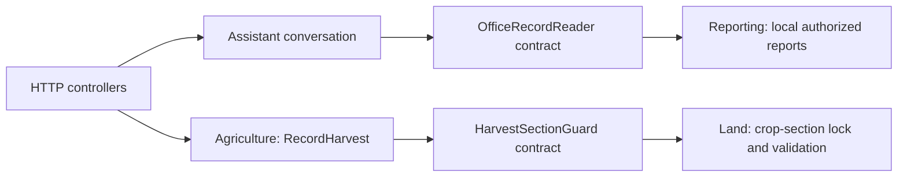

# Modular monolith

Status: implemented locally on `codex/modular-monolith`, October 16, 2026.
The deployed October 15 runtime remains unchanged until this refactor is released.

## Structure and ownership

eAgriLGU remains one Laravel application, one deployment and one existing
relational database. Fifty-four existing services moved from the broad Support,
Services and AI folders into seven business modules. The existing HTTP controllers,
Form Requests, policies, Eloquent model identities, migrations, Blade paths,
Artisan commands and route names remain the application/persistence adapters.

| Module | Owned application capabilities |
| --- | --- |
| `Farmers` | Registry identifiers, lookup, workspace geography, data-quality reports, card details and farmer-portal workflows |
| `Land` | Parcel/crop seasons, crop geometry, administrative-boundary references/imports and explicit sample-map setup |
| `Agriculture` | Assistance coverage, release quantity/import rules, distribution sheets, release-to-harvest projection and direct harvest writes |
| `AnimalHealth` | Animal-service validation, form options and multi-animal service recording |
| `Climate` | Office climate assessments, source readings, satellite summaries/budgets, Sentinel processing, weather and CHIRPS clients |
| `Assistant` | Identity, intent, conversation/context, reviewed knowledge retrieval, grounded help, provider budget and the help-generation agent |
| `Reporting` | Dashboard aggregates and authorized local Assistant reports across the existing shared read models |

Each module exposes application services under `App\Modules\<Module>\Application`.
Provider-specific weather/CHIRPS clients and the AI agent live in their owning
module's `Infrastructure` directory. New cross-module work should consume an
existing approved application API or a narrow `Contracts` interface. Do not reach
into another module's Infrastructure directory. `ModuleMap::IMPORTS` records the
small explicit set of existing cross-module APIs; architecture tests enforce it.

`app/Support` now contains only shared platform capabilities: AuditTrail, Cdn,
ConcurrentWrite, CsvExport, DatabaseBackup, GeoGeometry, LocalTime,
MunicipalityAccess, ProviderUsage and RegionSupervision. Domain workflows must
not accumulate there again. Namespace moves update every repository consumer,
including views, seeders, policies and isolated tests; no compatibility aliases
or duplicate implementations are maintained.

The October 18 local follow-up adds `App\Platform\Observability` for bounded
usage/performance aggregates. It has no business-module dependencies and adds no
domain helpers to Support. Its HTTP/database adapters are registered by
`UsageMetricsServiceProvider`; see [COST_EFFICIENCY.md](COST_EFFICIENCY.md) for the
combined release requirements.

## Two explicit module seams



`ModuleServiceProvider` is the composition root. It binds:

- `Assistant\Contracts\OfficeRecordReader` to `Reporting\Application\AssistantRecords`.
- `Land\Contracts\HarvestSectionGuard` to `Land\Application\CropSectionHarvestGuard`.

AssistantConversation receives the report contract. Reporting owns the actual
local reads and uses the same OfficeAssistantPolicy as the chat entry. It sends
no records to a provider. Canonical help generation and its existing disclosure,
limits, cache namespaces and source corpus retain their behavior. The existing
agent-source fingerprint now reads its moved file, so cached help can naturally
regenerate under the existing limits. Architecture tests prohibit AI
SDK or HTTP-client imports inside Reporting.

The direct-harvest controller now delegates create/update to `RecordHarvest`.
That action authorizes the operation, derives municipality ownership from the
scoped farmer/account, and uses the existing version check and transaction.
Inside that transaction, the Land contract locks and reauthorizes the selected
seasonal section and checks its farmer, parcel, year, season and crop. Form
Requests still validate submitted fields and related-record choices before an
action receives its validated array. Projected assistance harvests keep their
existing separate rules.

## Compatibility constraints

No table, column, record, account, provider setting, cache/session namespace or
public route changes. Eloquent model classes remain in `App\Models`: this keeps
polymorphic audit types, relationship resolution, route binding and HMAC edit
version identities stable. The sample import also retains its historical
`App\Support\RegionOneSampleData` audit discriminator as `AUDIT_TYPE`; changing
that persisted value would defeat the existing cohort-idempotency check.

Shared Eloquent models and HTTP/read adapters are an intentional compatibility
boundary. This release does not claim separate module databases, independent
module deployment or complete ORM encapsulation. Further extraction should be
driven by a concrete workflow and tested against current ownership rules.

The `app/Modules` hierarchy already fits Composer's existing `App\` PSR-4 rule;
no dependency update or new package is required. Do not rewrite historical
migrations or replace the existing Laravel bootstrap with a new project layout.

## Verification

- All 153 route definitions, actions and middleware match the captured baseline.
- The complete JavaScript suite passes 268 tests; no public JavaScript changed.
- The initial full Unit run passes 522 tests / 5,421 assertions (186 existing
  environment warning marks). The final architecture checks add audit-identity,
  provider-boundary and concrete-dependency-cycle coverage.
- The selected non-legacy feature run exercises 619 tests / 7,196 assertions.
  Its one failure was an unchanged CDN test still expecting Google Fonts after
  the prior Inter release; the corrected expectation and complete CDN suite pass.
  The assertion still rejects reintroduction of those external font origins.
- Module composition/policy tests, crop/harvest linking, Assistant reports/RAG,
  portal workflows, climate, scope isolation and presentation checks pass.
- The final architecture/composition run passes seven tests / 961 assertions,
  including resolution of every public Application service without HTTP calls.
  A structural comparison confirms 50 moved class bodies are unchanged apart
  from whitespace; the four reviewed differences are the report port/policy,
  conversation port, agent fingerprint path and preserved sample audit identity.
- The sample-import repeat test confirms the old audit discriminator and no-op
  behavior with synthetic data. Existing missing `.env.testing` warnings remain.

The blanket baseline run was stopped during expensive reference-seeder checks.
The selected run excludes named reference seeders/sample population and old
DatabaseTransactions suites that require a separately imported disposable legacy
schema. Pinned reference data is covered by Unit tests; the sample repeat case
was run separately. No tests or provider calls ran against production, and no
signed-in production acceptance is claimed for this local refactor.

Reproduce the isolated checks from PowerShell:

```powershell
php artisan test tests/Unit --compact
$moduleFeatureFiles = Get-ChildItem tests/Feature/*Test.php | Where-Object {
    $_.Name -notmatch 'BoundarySeeder|RegionOneSampleData|TarlacMunicipalityDemo' -and
    -not (Select-String -LiteralPath $_.FullName -Pattern 'DatabaseTransactions' -Quiet)
} | ForEach-Object { $_.FullName }
php artisan test @moduleFeatureFiles --compact
php artisan test tests/Feature/RegionOneSampleDataTest.php --filter=test_repeat_application_is_a_complete_no_op_including_timestamps_tokens_and_audit --compact
node --test tests/JavaScript/*.test.cjs
php artisan route:list
php artisan view:cache
```

## Release procedure

Release this refactor as one reviewed unit: all moved classes, namespace imports,
both contracts, the module provider, its config registration and policy mapping,
the controller extraction, views, tests and documentation. Splitting those
changes across releases can leave a missing class or contract binding.

After authorization, use the normal private-backup and GitHub fast-forward
deployment process. Regenerate the optimized autoloader from the existing lock
file with `composer dump-autoload --no-dev --optimize --no-scripts`, then rebuild
configuration, route and Blade caches. Preserve private environment values,
session/cache namespaces and existing budgets. No migration, seed, account
operation, dependency update, public-asset mirror or general-cache clear is
required. Restart an existing long-lived worker only if one is in use.

Before accepting a release, check module contract resolution, office/farmer
sign-in, scoped reports, crop/harvest workflows and map rendering. External or
private maintenance scripts that imported the former Support service names must
be updated to the new module namespace before reuse. Restore the prior complete
runtime and autoloader/caches together if rollback is required.
